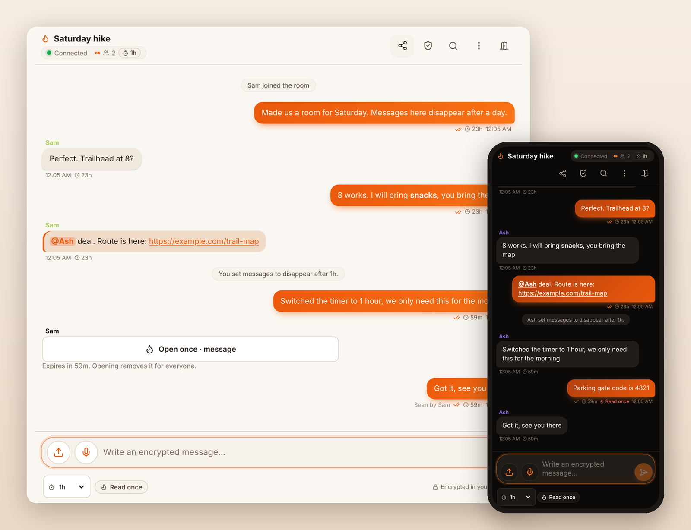
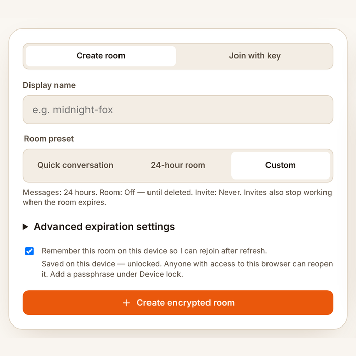
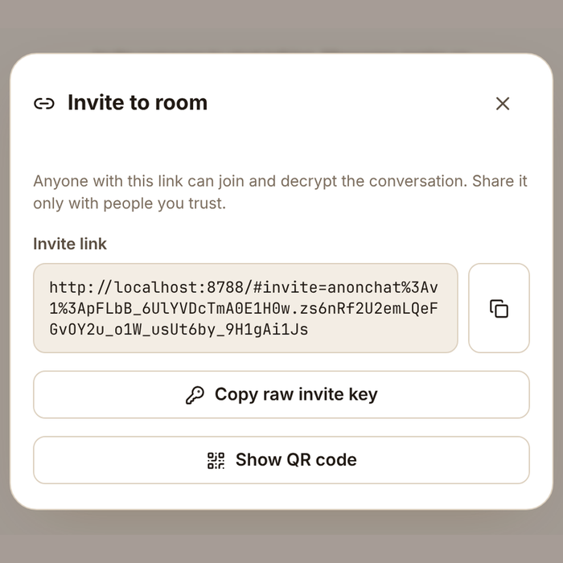
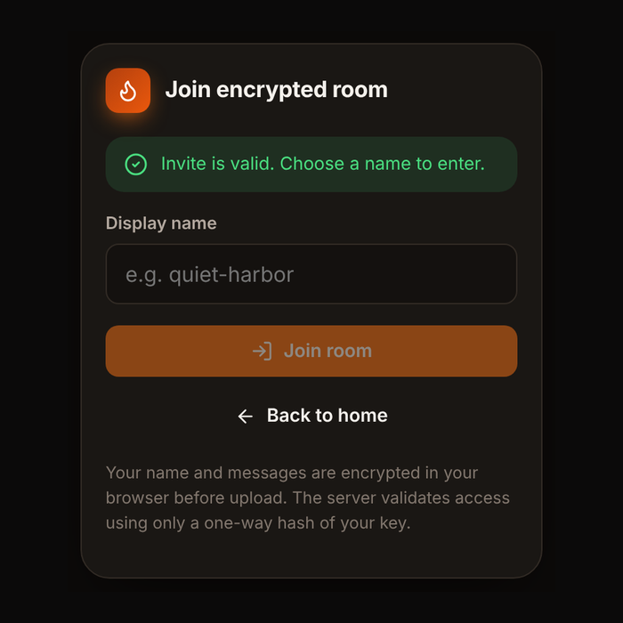
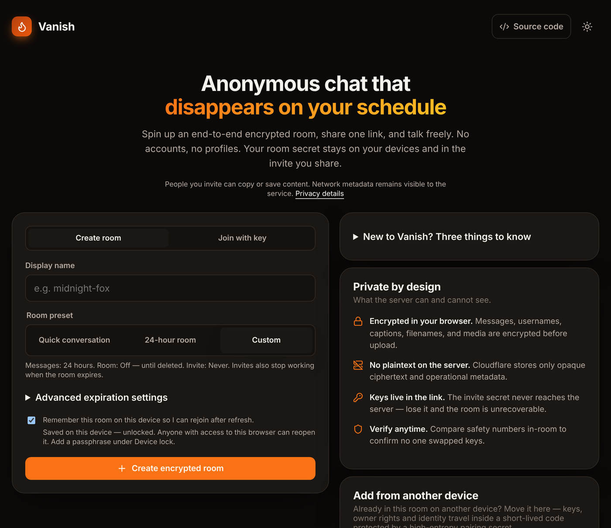

<div align="center">


# Vanish

**Anonymous group chat that disappears on your schedule.**

End-to-end encrypted in your browser. No accounts, no phone numbers, no profiles. Just a link.

[**Try it live**](https://chat.builtwai.com) · [Run it on your computer](#run-it-on-your-computer) · [Put it online](#put-it-online) · [How it works](docs/HOW-IT-WORKS.md)

[](https://github.com/genisis-lab/vanish/actions/workflows/ci.yml)
[](LICENSE)



</div>

## What is Vanish?

Vanish is a private group chat you can start in seconds. Pick a display name, create a room,
and share the invite link. Everything you send (messages, names, photos, voice notes, file
names) is encrypted in your browser **before** it leaves your device, so the server only ever
stores scrambled data it has no key for.

- **Nothing to sign up for.** No email, phone number, or password. Close the tab and you leave
  no account behind.
- **Messages delete themselves.** Pick how long messages last (from 30 seconds to 7 days, or
  never), send "read once" messages that vanish after they're opened, or set the whole room
  to self-destruct.
- **The link is the key.** The room's secret lives only in the invite link and on your
  devices. If every copy is lost, nobody (including the server) can recover the room.
- **Works everywhere.** Any modern browser on desktop or phone. Install it like an app, with
  optional notifications.

## Using Vanish

| 1. Create a room | 2. Share the invite | 3. Friends join |
| :---: | :---: | :---: |
|  |  |  |
| Choose a name and how long things should last. **Quick conversation** and **24-hour room** are one-tap presets. | Send the link (or show the QR code) over a channel you trust. Anyone with it can read the room. | They open the link, pick a name, and they're in. No app or account needed. |

A few things worth knowing once you're in:

- **The timer is shared.** Anyone in the chat can change how long new messages last, and
  everyone sees a note when it changes. Room owners can lock it.
- **Read once** (next to the timer) sends a message that stays covered until someone opens
  it, then disappears for everyone.
- **Formatting works:** `**bold**`, `*italics*`, `` `code` ``, and `@name` to mention someone.
  Links are clickable but never fetched or previewed by Vanish.
- **Check who you're talking to** with the shield button, which shows the room's safety
  number. See [Staying safe and verifying people](docs/SAFETY-AND-IDENTITY.md).
- **Owners** (whoever created the room) can set a topic, pin a message for everyone, ban
  people, lock the timer, and delete the room.

## Run it on your computer

You can run the whole thing locally (web app, API, encrypted storage) with one command. No
Cloudflare account needed.

### What you need

- **Node.js 22 or newer.** Check with `node -v`. Get it from [nodejs.org](https://nodejs.org).
- **Git**, to download the code.

### Start it

```bash
git clone https://github.com/genisis-lab/vanish.git
cd vanish
npm start
```

The first run installs dependencies, so give it a minute. When it's ready you'll see:

```
✓ Vanish is running

    Open      http://localhost:8788
    Try it    Create a room, then open the invite link in a private window
              to chat with yourself.
    Stop      Press Ctrl+C
```

Open **http://localhost:8788** and you'll see the home page:



Create a room, then paste the invite link into a private (or incognito) window. Each window
acts like a separate person, so you can chat with yourself and see both sides.

### What `npm start` does

1. Checks your Node.js version and runs `npm install` if dependencies are missing.
2. Creates a random local upload secret in `.dev.vars` (git ignores this file).
3. Builds the web app into `dist/`.
4. Starts the room server and the web app together, sharing local storage in
   `.wrangler/state`.
5. Turns off the per-address rate limits, so you can create as many test rooms as you like.

Press **Ctrl+C** to stop both servers. Your local rooms are kept for next time.

| Option | What it does |
| --- | --- |
| `npm start -- --port 3000` | Use a different port for the web app (default 8788, or the next free one) |
| `npm start -- --skip-build` | Reuse the last build for a faster restart |
| `npm start -- --verbose` | Show the full server logs, including every request |
| `npm start -- --help` | List the options |

### If something goes wrong

- **"Vanish needs Node.js 22 or newer"**: install the current LTS from
  [nodejs.org](https://nodejs.org), open a new terminal, and run `npm start` again.
- **"Port … is already in use"**: you asked for a specific port that's taken. Pick another
  with `--port`, or leave it out and Vanish finds a free one.
- **Messages take about a second to show up**: that's expected locally. The local Cloudflare
  emulator can't hand live connections from the web app to the room server, so the app falls
  back to checking for new messages every second. The deployed version updates instantly.
- **A page hangs while loading**: reload it. The local emulator sometimes stalls a new page
  load for a few seconds, usually right after another chat window was closed. This is a
  local-only quirk.
- **Start over with empty rooms**: stop Vanish and delete the `.wrangler/state` folder.
- **Anything else**: run `npm start -- --verbose` to see what the servers are saying.

## Put it online

Vanish runs on Cloudflare (Pages, Workers, Durable Objects, R2, and Queues). With a
Cloudflare account, the one-time setup is:

```bash
npx wrangler login
npx wrangler r2 bucket create vanish-media
npx wrangler queues create vanish-moderation-reports
npx wrangler queues create vanish-moderation-reports-dlq
npm run worker:deploy
npx wrangler pages project create vanish --production-branch main
npx wrangler pages secret put UPLOAD_SECRET --project-name vanish   # paste a random value, e.g. from: openssl rand -base64 32
npm run build && npm run pages:deploy
```

After that, `npm run deploy` ships updates in the right order. The
[deployment guide](docs/DEPLOY.md) explains each step and covers push notifications,
custom domains, automatic deploys from GitHub, and every environment variable.

## For developers

### Checks

```bash
npm test            # unit tests (vitest)
npm run typecheck   # TypeScript across the web app, functions, and worker
npm run build       # production build with Subresource Integrity hashes
npm run test:e2e    # browser tests (Playwright) against the full local stack
```

CI runs all four on every pull request. What the suites cover:

- **Crypto**: the same key round-trips; a wrong key fails to decrypt; a tampered ciphertext
  fails the GCM auth tag; message / media / proof keys are independent; epoch (v2) envelopes
  round-trip and v1 envelopes still decode.
- **API**: invalid invites are denied; expired invites are blocked from joining (but existing
  data is preserved); rejoin works; multiple participants can join; prune, delete, edit, and
  owner actions require a valid proof.
- **E2E**: two browser contexts create and join a room, exchange live text, upload an
  image/video, decrypt and download it, prune messages, and delete the room.
- **Privacy**: assertions that no plaintext message text, usernames, filenames, or media bytes
  are ever present in server-bound payloads.

### Running the pieces yourself

`npm start` is a wrapper around these commands. Run them directly if you want to work on one
part at a time:

```bash
npm run dev                                            # web app only (Vite, http://localhost:5173), no API
npm run build                                          # needed before pages:dev, which serves dist/
npm run worker:dev -- --persist-to .wrangler/state     # terminal 1: room Worker (Durable Objects, R2, queue)
npm run pages:dev -- --persist-to .wrangler/state      # terminal 2: web app + /api functions on :8788
```

Give both Wrangler processes the same `--persist-to` folder so they share one local R2
bucket. `pages:dev` reads `UPLOAD_SECRET` from `.dev.vars` (`npm start` creates it, or add
`UPLOAD_SECRET=anything-random` yourself). Build-time options live in `.env`; copy
`.env.example` to start.

### Project layout

```
src/           React + Vite web app (lib/ logic, components/ UI, styles/)
functions/     Cloudflare Pages Functions: the HTTP API and WebSocket entry
room-worker/   Companion Worker hosting the room and rate-limit Durable Objects
shared/        Crypto, invite, and room logic shared by client and server
public/        PWA manifest, service worker, icons, _headers (CSP), _routes.json
scripts/       start.mjs, the one-command local runner behind npm start
docs/          Deployment, how it works, safety guide, native apps, README images
tests/         unit (vitest) · e2e (playwright) · manual (tsx verify)
```

### Native apps

The iOS and Android apps are a thin [Capacitor](https://capacitorjs.com) shell around the
deployed web app. See [docs/NATIVE.md](docs/NATIVE.md) for setup, signing, and store notes.

## Privacy and security at a glance

- Messages, usernames, captions, filenames, and media are encrypted in your browser
  (AES-GCM-256) before upload. The server stores only ciphertext and cannot read it.
- Message keys rotate every hour, and every message is signed by the sender's device, so
  holding the room key alone doesn't let someone pose as another member.
- Background notifications carry no message content, only "something new in this room".
- Anyone with the invite link can join and read the room. Share it only with people you trust.
- Vanish can't stop people in the room from copying or screenshotting what they see, and
  Cloudflare still sees network metadata such as IP addresses and timing.
- It uses strong, modern cryptography, but it has not been independently audited and is not
  meant for legal, military, or classified use.

The full details, including the encryption design, architecture, and threat model, are in
[How Vanish works](docs/HOW-IT-WORKS.md).

## License

Vanish is released under the [MIT License](LICENSE).
